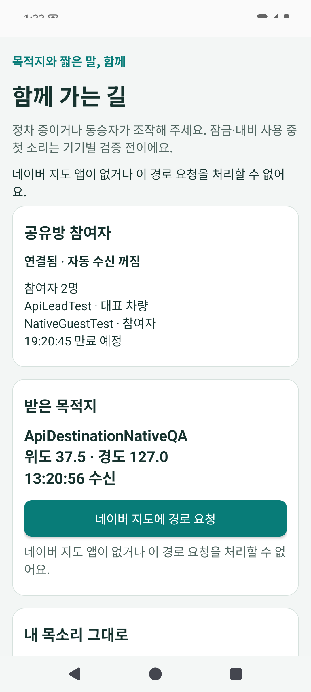
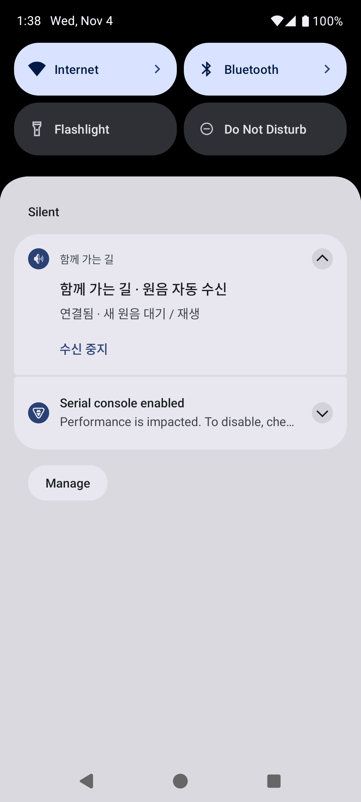
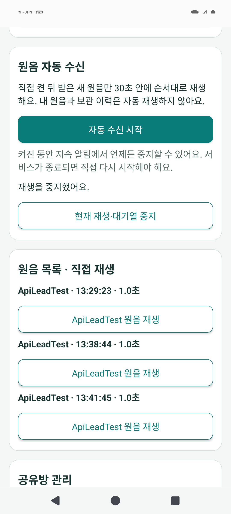
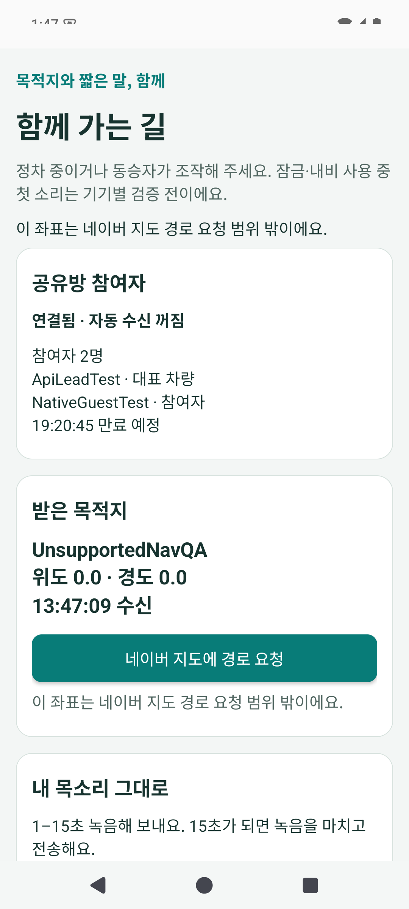
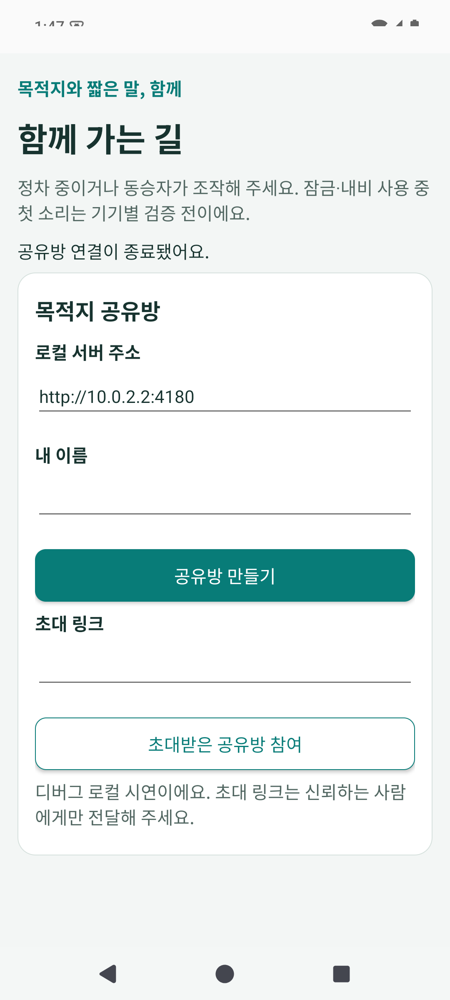

# Android 에뮬레이터 검증

2026-11-04, 이 작업 전용 AOSP API 35 ARM64 AVD `PleosApi35`에 실제 디버그 APK를 설치했다. SDK의 UI XML과 화면 캡처를 읽고 해당 컨트롤을 조작했다. 서버는 호스트의 `127.0.0.1:4180`이며 앱은 디버그 전용 `10.0.2.2:4180` 별칭으로 연결했다. 사용자 계정·물리 휴대폰·다른 ADB 인스턴스는 사용하지 않았다.

정확한 APK 해시, 검사별 버전, AudioFocus 관찰과 화면 해시는 [emulator.json](emulator.json), 20개 JVM/API 테스트·lint·APK 서명 결과와 소스 해시는 [build.json](build.json)에 있다. 초기 APK에서 생성·목적지·마이크 권한 거절·참여·전경 원음 재생을 확인했다. 네이버 경로 요청을 추가한 최신 APK로 업데이트한 뒤 세션 복원·수신 선택 초기화·백그라운드 수신·알림 중지·지도 요청 실패·탈퇴를 확인했다.

## 실제 관찰

- 네이티브 대표 차량이 공유방을 만들고 목적지를 전달한 뒤 종료했다. 별도 API 대표 차량의 웹 형식 초대 링크로 네이티브 참여자가 가입하고 새 목적지를 받았다.
- 마이크 권한 거절 시 녹음을 시작하지 않았다. 실제 마이크 입력·15초 녹음·녹음 취소의 장치 동작은 검사하지 않았다.
- 사용자가 자동 수신을 켜면 지속 알림이 생겼다. 앱 대신 Launcher3가 전경인 상태에서 가상 1초 WAV를 전송했고, 앱을 다시 열기 전에 해당 앱의 새 AudioFocus 요청·반납을 관찰했다.
- 알림의 `수신 중지`를 누르면 foreground service가 종료됐다. 그 후 보낸 새 원음에는 앱 AudioFocus 항목이 추가되지 않았고 앱 화면도 자동 수신 꺼짐을 표시했다.
- 네이버 지도 미설치와 지원 범위 밖 `0,0` 좌표는 각각 실패를 표시하고 받은 목적지를 유지했다. 지도 앱 설치·실제 길 안내는 실행하지 않았다.
- 네이티브 참여자가 나간 뒤 실제 서버의 참여자는 대표 한 명만 남았다. 가상 대표의 방도 종료해 테스트 원음과 참여 상태를 정리했다.

## 화면

## 검증 한계

에뮬레이터는 `-no-audio`로 실행했다. 입력 WAV는 가상 PCM 표본이며 사람의 녹음이 아니다. AudioTrack 상태·AudioFocus 이벤트·완료 문구는 물리 스피커의 실제 첫 소리 증거가 아니다. 이 검증은 Galaxy 내비 사용, 화면 잠금, 15분·30분 무음 뒤 첫 원음 재생을 통과시키지 않는다. 필수 실기기 항목은 [제품 검증표](../../../docs/product/platform-validation.md)에 미검증으로 남긴다.
