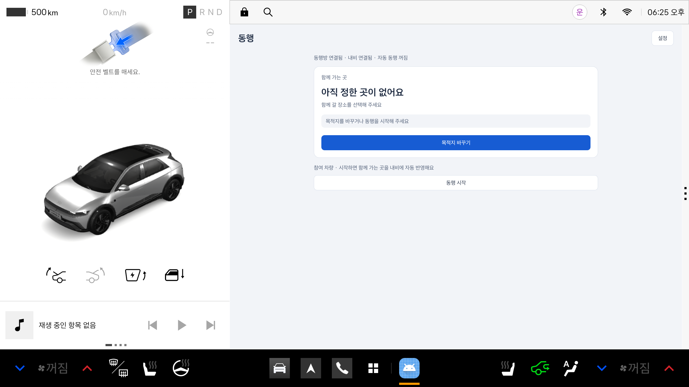
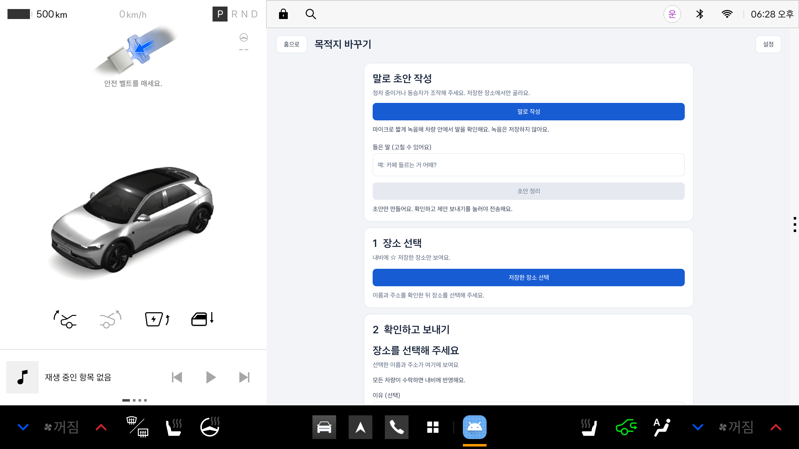

# One-click two-vehicle launcher — issue27

Prepared and exercised on the approved Mac with dedicated ADB5041, Pleos12Leader5570 and Pleos12Follower5572, user10. Product/server code, installed APK, earlier evidence and the original checkout are unchanged.

The implementation under test is commit `3db09e0714e86cde6c83642977500e53cec0ff0d`, based on main `4a9865f1b1584cb13a32f3a7022b08928ebad158`. Launcher SHA256 is `172553d4510986da142de3b230ac0f32e517d53532b2f5079880dd0e7e53d8c0`; entry SHA256 is `9eb99d3fe19a8f0f1b4f1dfc29236d3db28f9c25de73e626ceeec21c20c38ba0`, mode0755. The unchanged installed APK SHA256 is `5b9eec0cca7f645e25ef4615cd5096d8e31b9256141d35f8d5018bc2c398317e`.

| Verification | Result and artifact |
|---|---|
| Actual cold entry | [cold5](root/cold5-result.json): normal dedicated AVD/ADB stop, actual LaunchServices entry, two correct app panes and room restoration in139.501s. |
| Warm/concurrent entry | [final-warm3](root/final-warm3-result.json): actual exits0/3,18.224s, same process IDs, B compose page preserved, intentionally missing4182 paths repaired. |
| Both addresses on both vehicles | [API](root/final-default-api-result.json): four actual guest4182/4192 room create201/delete200 pairs; isolated probe identities only. |
| Preserved resources | [preservation](root/final-preservation-result.json):4190/4192 full process identity, original issue7 checkout/head/clean state, current room connections. |
| Automated regression | [builder report](builder/builder-report-172553d4.json), [independent result](verifier/unittest-3db09e0.result.json):38 tests each, including real isolated Node cold-start/reuse/room lifecycle. |
| Independent source review | [review](verifier/source-review-3db09e0.md), [audit](verifier/source-audit-3db09e0.json), [observed pane replay](verifier/observed-pane-3db09e0.json). |
| Independent actual cold audit | [cold5](verifier/cold5-audit-3db09e0.json): screenshots/XML/journal suffixes, exact source, process/room/pane/microphone/route checks. |

The independent [warm/API audit](verifier/warm-api-audit-3db09e0.json) confirms both final screenshots, byte-identical B compose XML and exact actual-entry logs.

The [frozen issue](root/issue-27-frozen.md), [operator report](root/root-report.md), [execution limit](root/execution.json) and [artifact manifest](artifact-manifest.json) retain scope, commands, provenance, failures, limits and SHA256/byte counts. The logs folder contains curated launcher events, not raw subprocess output or private configuration. Full fresh-archive test trees, SDK/APK binaries and credentials are excluded.

The final evidence-only commit requires an independent exact-head rebind. Its final report is posted verbatim on [PR28](https://github.com/wontop02/pleos-destination-share/pull/28), followed by actual merged/main/issue27 closure checks. This premerge package does not presume that those GitHub operations have already occurred. It is AI verification under the repository's separate builder/verifier contexts, not a separate-account GitHub approval.

## Actual screens

A after the final cold entry:

B after the final cold entry:

B's compose page remains open after concurrent warm entry:

## Preserved failures

Earlier source failures and operator instrumentation errors remain in `root/` with their original false result. They are explained individually in the operator report. In particular cold3 passed an earlier source; cold4 failed; neither substitutes for final cold5. The final-warm and final-warm2 preparation errors happened before launcher invocation; only final-warm3 is the accepted actual concurrent case. Invitation values and typed private input were never captured. UIAutomator reports the two fixed source hints as EditText text; the final capture guard allows those exact hint strings only.

No full Mac reboot, route application, microphone recording or new permission grant was performed. Native SDK state was observed CONNECTED in the final cold captures, but this task does not repeat the prior route/voice feature acceptance. The launcher itself does not manage rooms, install APKs, terminate vendor components, wipe/restore AVDs or alter global settings. Live dedicated resources remain ready for the user's demonstration.
